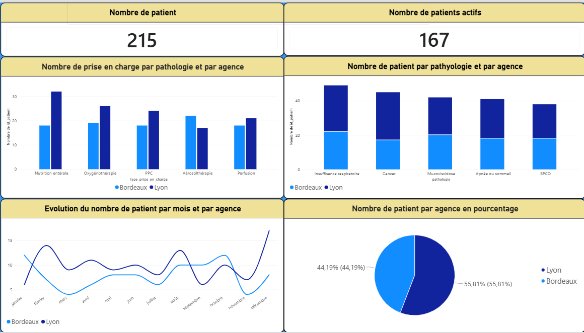
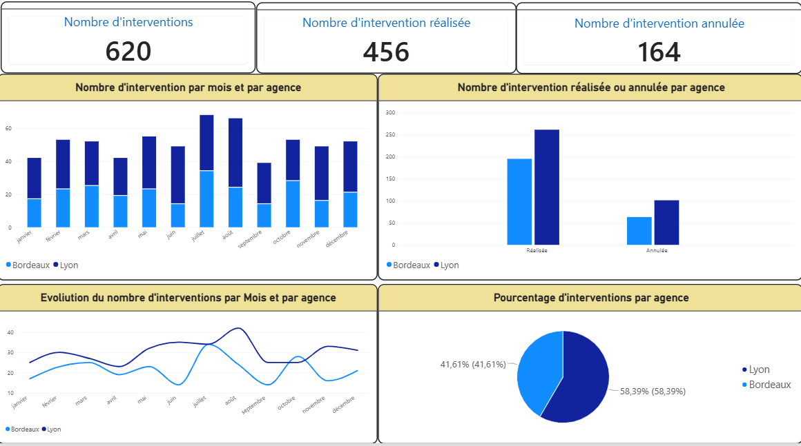
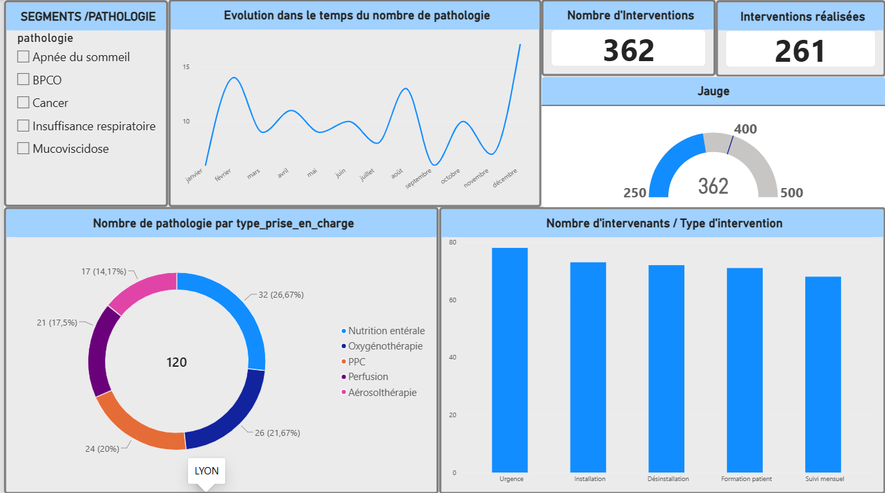
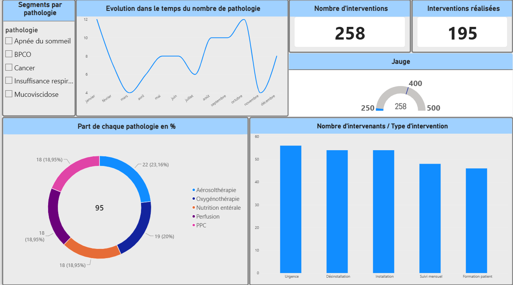
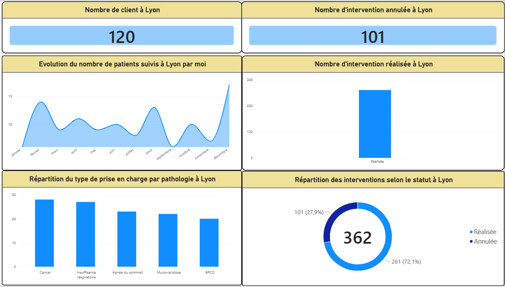
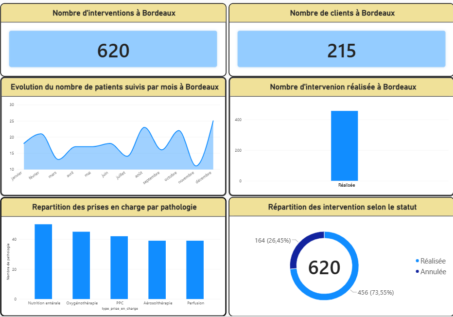

# 📊 Analyse comparative des agences de Lyon et Bordeaux — Oxygène Médical (Exercice 2024)

Ce projet présente l'analyse comparative des activités des agences de **Lyon** et **Bordeaux**, spécialisées dans la fourniture et la livraison d'oxygène médical à domicile et en établissement. L'objectif est d'évaluer la performance opérationnelle et commerciale à travers deux axes majeurs.

---

## 🔍 Contexte et Objectifs
Dans une perspective d’optimisation des opérations et de pilotage de la performance territoriale, cette étude analyse :
1. **La typologie des pathologies prises en charge** (structure de la patientèle et volumes de consommation).
2. **La répartition des 5 types d'interventions** (installation initiale, renouvellement, maintenance, urgence et retrait) pour analyser l’efficience logistique et l'allocation des ressources.

---

## 📈 Résultats et Analyses Régionales

### 1. Spécificités régionales & Typologie des pathologies
- **Répartition de la patientèle** : Prédominance de l’agence de Lyon avec **55,81 %** des patients, contre **44,19 %** pour Bordeaux (sur un total de 215 patients, dont 167 actifs).
- **Enseignements** : Lyon est plus fortement représentée sur plusieurs catégories de pathologies, tandis que Bordeaux présente une répartition plus équilibrée. Ces écarts nécessitent une gestion différenciée des stocks et des équipements d'assistance.

### 2. Efficience opérationnelle & Interventions
- **Volume d'interventions** : Total de 620 interventions enregistrées, dont 456 réalisées et 164 annulées.
- **Répartition par agence** : Poids opérationnel plus important pour Lyon (**58,39 %** des interventions) que pour Bordeaux (**41,61 %**).
- **Enseignements** : Activité plus soutenue et fluctuante à Lyon avec des pics marqués. Le niveau d'annulations invite à renforcer le pilotage des tournées, l'anticipation des besoins et la standardisation des processus.

---

## 🚀 Préconisations Stratégiques
1. **Standardisation des pratiques** : Harmoniser les protocoles d’intervention en s’appuyant sur les indicateurs de performance les plus favorables des deux agences.
2. **Optimisation logistique** : Ajuster les niveaux de stocks régionaux de bouteilles d’oxygène au regard des prévisions de consommation propres à chaque groupe de pathologies.
3. **Suivi continu** : Mettre en place un tableau de bord mensuel unifié pour piloter les cinq types d’interventions selon des critères homogènes.

---

## 🖼️ Aperçu du Tableau de Bord Power BI

| Vue 1 : Typologie des Pathologies | Vue 2 : Analyse des Interventions |
| :---: | :---: |
|  |  |

### 📊 Visuels détaillés des Agences

| Agence de Lyon | Agence de Bordeaux |
| :---: | :---: |
|  |  |
|  |  |

---
*Rapport d'analyse 2024 — Pilotage de la performance territoriale.*